# Diagrama de Clases UML — Gym Simulator ("La Copa del Barrio")

Este documento contiene el código en **Mermaid** actualizado con todos los cambios del proyecto, manteniendo la estructura aprobada por el docente en el diagrama original y cumpliendo estrictamente:
1. **Cero islas:** todas las clases e interfaces están conectadas mediante relaciones UML formales (composición, agregación, herencia, realización, asociación o dependencia).
2. **Cero clases sin atributos y/o sin métodos:** todas las clases tienen tanto sección de atributos como sección de métodos (y los 5 `enum` del dominio se mantienen como **notas amarillas**, tal como aprobó el docente).
3. **100% sincronizado con el código fuente actual:** nombres de atributos, constructores sobrecargados (`Personaje(String, Objetivo)`) y métodos coinciden exactamente con las clases Java del proyecto.

## Cómo importarlo en Draw.io (`app.diagrams.net`)
1. Abrí [app.diagrams.net](https://app.diagrams.net/).
2. En el menú superior, elegí **Organizar → Insertar → Avanzado → Mermaid...** (*Arrange → Insert → Advanced → Mermaid...*).
3. Pegá el bloque de código Mermaid de abajo (sin las comillas triples ```` ```mermaid ````) y hacé clic en **Insertar**.

---

## Código Mermaid (`classDiagram`)

```mermaid
classDiagram
    direction TB

    %% ==========================================
    %% PAQUETE VISTA
    %% ==========================================
    class VentanaPrincipal {
        -GestorJuego controlador
        -JTextField txtNombre
        -JComboBox~Objetivo~ cbObjetivo
        -JButton btnIniciarPartida
        -PanelEstadisticas panelEstadisticas
        -PanelGimnasio panelGimnasio
        -PanelMusculos panelMusculos
        +VentanaPrincipal()
        +actualizarVista() void
        -iniciarPartida() void
        -mostrarPantallaInicio() void
        -mostrarPantallaJuego() void
        -mostrarPantallaFin(String tituloResultado, String mensajeHistoria) void
    }

    class PanelEstadisticas {
        -GestorJuego controlador
        -JLabel lblPersonajeNivel
        -JLabel lblDia
        -JLabel lblTiempo
        -JProgressBar barraFuerza
        -JProgressBar barraResistencia
        -JProgressBar barraEnergia
        -JProgressBar barraMotivacion
        -JButton btnCerrarDia
        +actualizar() void
        +estilizarBotonRetro(JButton boton)$ void
        +estilizarBotonPixelArt(JButton boton, Font fuente, Insets margenes)$ void
    }

    class PanelMusculos {
        -GestorJuego controlador
        -JLabel[] lblNombres
        -JProgressBar[] barrasFatiga
        -JLabel[] lblEstados
        +actualizar() void
        -crearTarjetaMusculo(int indice) JPanel
    }

    class ComparadorPorFatiga {
        -boolean descendente
        +compare(GrupoMuscular g1, GrupoMuscular g2) int
    }

    class Comparator_GrupoMuscular {
        <<interface>>
        +compare(GrupoMuscular g1, GrupoMuscular g2) int
    }

    class PanelGimnasio {
        -GestorJuego controlador
        -OyenteEstacion oyenteEstacion
        -Image imagenEscenario
        -Map~String, Image~ spritesEstaciones
        -Image[] cuadrosPersonaje
        -Image[] cuadrosFrente
        -Image[] cuadrosEspalda
        -int personajeX
        -int personajeY
        -boolean enMovimiento
        -int orientacionActual
        +moverPersonajeHacia(int destinoX, int destinoY, Runnable accionAlLlegar) void
        +animarSalidaGimnasio(Runnable alLlegarASalida) void
        +animarEntradaGimnasio(Runnable alLlegarAlCentro) void
        +ubicarPersonajeEn(int x, int y) void
        #paintComponent(Graphics g) void
    }

    class OyenteEstacion {
        <<interface>>
        +alSeleccionarEstacion(EstacionGimnasio estacion) void
    }

    class MovimientoPersonaje {
        -int destinoX
        -int destinoY
        -int opacidadInicial
        -int opacidadFinal
        -Runnable accionAlLlegar
        -MovimientoPersonaje(int destinoX, int destinoY, int opacidadIni, int opacidadFin, Runnable accion)
        +run() void
    }

    class Runnable {
        <<interface>>
        +run() void
    }

    class DialogoEvento {
        -int indiceSeleccionado
        -static final Font FUENTE_TITULO
        +DialogoEvento(JFrame ventanaPadre, EventoAleatorio evento)
        +getIndiceSeleccionado() int
        -formatearTextoOpcion(OpcionEvento opcion) String
    }

    %% ==========================================
    %% PAQUETE CONTROLADOR
    %% ==========================================
    class GestorJuego {
        -Personaje personaje
        -List~EstacionGimnasio~ estaciones
        -List~Nivel~ niveles
        -List~EventoAleatorio~ eventos
        -Random azar
        -int indiceNivelActual
        -int diaActual
        -int tiempoRestante
        -EventoAleatorio eventoPendiente
        -static final int TIEMPO_POR_DIA = 90
        -static final double PROBABILIDAD_EVENTO = 0.30
        -List~RegistroDia~ historial
        +GestorJuego(Personaje p, List~EstacionGimnasio~ est, List~Nivel~ niv)
        +GestorJuego(Personaje p, List~EstacionGimnasio~ est, List~Nivel~ niv, List~EventoAleatorio~ ev, Random azar)
        +validarAccion(EstacionGimnasio estacion) void
        +procesarAccion(EstacionGimnasio estacion) void
        +verificarVictoria() boolean
        +verificarDerrota() boolean
        +perdioPorBurnout() boolean
        +perdioPorTiempo() boolean
        +cerrarDia() boolean
        +hayEventoPendiente() boolean
        +getEventoPendiente() EventoAleatorio
        +resolverEvento(int indiceOpcion) void
    }

    class RegistroDia {
        -int numeroNivel
        -int numeroDia
        -int energiaFinal
        -int motivacionFinal
        -int fuerzaFinal
        -int resistenciaFinal
        -RegistroDia(int nivel, int dia, int energia, int motivacion, int fuerza, int resistencia)
        +compareTo(RegistroDia otro) int
        +getNumeroNivel() int
        +getNumeroDia() int
    }

    class Comparable_RegistroDia {
        <<interface>>
        +compareTo(RegistroDia otro) int
    }

    %% ==========================================
    %% PAQUETE MODELO
    %% ==========================================
    class Nivel {
        -int numero
        -String nombre
        -int fuerzaObjetivo
        -int resistenciaObjetivo
        -int diasDisponibles
        +Nivel(int numero, int fuerzaObj, int resistenciaObj, int diasDisp)
        +Nivel(int numero, String nombre, int fuerzaObj, int resistenciaObj, int diasDisp)
        +objetivoCumplido(Personaje p) boolean
        +getNombre() String
    }

    class CatalogoEventos {
        +static final int MAX_PENALIZACION_ENERGIA = -20
        -CatalogoEventos()
        +crearEventos()$ List~EventoAleatorio~
    }

    class EventoAleatorio {
        -String descripcion
        -List~OpcionEvento~ opciones
        +EventoAleatorio(String descripcion, List~OpcionEvento~ opciones)
        +aplicar(Personaje p, OpcionEvento elegida) void
        +aplicar(Personaje p, int indiceOpcion) void
        +getDescripcion() String
        +getOpciones() List~OpcionEvento~
    }

    class OpcionEvento {
        -String texto
        -int deltaEnergia
        -int deltaMotivacion
        +OpcionEvento(String texto, int deltaEnergia, int deltaMotivacion)
        +getTexto() String
        +getDeltaEnergia() int
        +getDeltaMotivacion() int
    }

    class EstacionGimnasio {
        <<abstract>>
        #String nombre
        #int x
        #int y
        #EstacionGimnasio(String nombre, int x, int y)
        +interactuar(Personaje p)* void
        +getCostoTiempo()* int
        +getMotivoNoUsable(Personaje p) String
        +puedeUsarse(Personaje p) boolean
        +getNombre() String
        +getX() int
        +getY() int
    }

    class BancoDescanso {
        -DuracionDescanso duracionSeleccionada
        +seleccionarDuracion(DuracionDescanso d) void
        +getDuracionSeleccionada() DuracionDescanso
        +interactuar(Personaje p) void
        +getCostoTiempo() int
    }

    class MaquinaMuscular {
        -TipoMusculo grupoQueTrabaja
        -int impactoFuerza
        -int costoTiempo
        -int costoEnergia
        -static final int PENALIZACION_SOBRECARGA = -5
        +MaquinaMuscular(String nombre, int x, int y, TipoMusculo grupo)
        +MaquinaMuscular(String nombre, int x, int y, TipoMusculo grupo, int imp, int t, int e)
        +getMotivoNoUsable(Personaje p) String
        +interactuar(Personaje p) void
        +getCostoTiempo() int
    }

    class Heladera {
        -int recuperacionEnergia
        -int costoTiempo
        +interactuar(Personaje p) void
        +getCostoTiempo() int
    }

    class Cardio {
        -DuracionCardio duracionSeleccionada
        +seleccionarDuracion(DuracionCardio d) void
        +getDuracionSeleccionada() DuracionCardio
        +interactuar(Personaje p) void
        +getCostoTiempo() int
    }

    class Personaje {
        -String nombre
        -int edad
        -Objetivo objetivo
        -int fuerza
        -int resistencia
        -int energia
        -int motivacion
        -Map~TipoMusculo, GrupoMuscular~ gruposMusculares
        +Personaje(String nombre, Objetivo objetivo)
        +Personaje(String nombre, int edad, Objetivo objetivo)
        +consumirEnergia(int cantidad) void
        +desmayarse() void
        +sumarFuerza(int cantidad) void
        +sumarResistencia(int cantidad) void
        +sumarEnergia(int cantidad) void
        +sumarMotivacion(int cantidad) void
        +recuperarEnergiaDiaria() void
        +reiniciarFatigaGrupos() void
        +pasarDia() void
    }

    class GrupoMuscular {
        -TipoMusculo tipo
        -int nivelFatiga
        -EstadoFatiga estado
        -int diasLesionRestantes
        -List~Integer~ historialEstimulo
        +obtenerEfectividad() double
        +registrarEntrenamiento() void
        +recuperar(int cantidad) void
        +getDiasLesionRestantes() int
        ~pasarDia() void
        ~reiniciar() void
        ~actualizarEstado() void
    }

    %% ==========================================
    %% PAQUETE EXCEPCIONES
    %% ==========================================
    class TiempoInsuficienteException {
        -static final long serialVersionUID = 1L
        +TiempoInsuficienteException(String mensaje)
    }

    class DatosInvalidosException {
        -static final long serialVersionUID = 1L
        +DatosInvalidosException(String mensaje)
    }

    %% ==========================================
    %% NOTAS DE DOMINIO (ENUMS)
    %% ==========================================
    note for Personaje "Dominio Objetivo:\n{HIPERTROFIA, FUERZA, RESISTENCIA}"
    note for GrupoMuscular "Dominio TipoMusculo:\n{PECHO, ESPALDA, PIERNAS, HOMBROS, BRAZOS}\nDominio EstadoFatiga:\n{OPTIMO, FATIGADO, SOBRECARGADO, LESIONADO}"
    note for BancoDescanso "Opciones DuracionDescanso:\n{CORTO (1m), MEDIO (2m), LARGO (3m)}"
    note for Cardio "Opciones DuracionCardio:\n{CORTO (5m), MEDIO (10m), LARGO (15m)}"

    %% ==========================================
    %% RELACIONES
    %% ==========================================
    %% Vista -> Controlador y paneles
    VentanaPrincipal "1" --> "1" GestorJuego : coordina / inicia
    VentanaPrincipal "1" *-- "1" PanelEstadisticas : compone
    VentanaPrincipal "1" *-- "1" PanelGimnasio : compone
    VentanaPrincipal "1" *-- "1" PanelMusculos : compone
    VentanaPrincipal ..> DialogoEvento : abre
    VentanaPrincipal ..> CatalogoEventos : solicita catálogo
    DialogoEvento ..> EventoAleatorio : muestra

    PanelMusculos "1" *-- "1" ComparadorPorFatiga : compone (clase interna)
    ComparadorPorFatiga ..|> Comparator_GrupoMuscular : realiza

    PanelGimnasio --> "1" OyenteEstacion : notifica
    PanelGimnasio ..> MovimientoPersonaje : ejecuta en Thread
    MovimientoPersonaje ..|> Runnable : realiza

    %% Controlador -> Modelo
    GestorJuego "1" *-- "1..*" Nivel : gestiona
    GestorJuego "1" *-- "0..*" RegistroDia : compone (clase anidada)
    GestorJuego "1" ..> "0..*" EventoAleatorio : dispara
    GestorJuego "1" o-- "1..*" EstacionGimnasio : agrega
    GestorJuego "1" *-- "1" Personaje : compone
    GestorJuego ..> TiempoInsuficienteException : «throws»

    RegistroDia ..|> Comparable_RegistroDia : realiza
    CatalogoEventos ..> EventoAleatorio : instancia
    EventoAleatorio "1" *-- "2..*" OpcionEvento : compone (clase anidada)

    %% Jerarquía EstacionGimnasio
    EstacionGimnasio <|-- BancoDescanso
    EstacionGimnasio <|-- MaquinaMuscular
    EstacionGimnasio <|-- Heladera
    EstacionGimnasio <|-- Cardio

    %% Personaje y GrupoMuscular
    Personaje "1" *-- "5" GrupoMuscular : compone
    Personaje ..> DatosInvalidosException : «throws»
```


